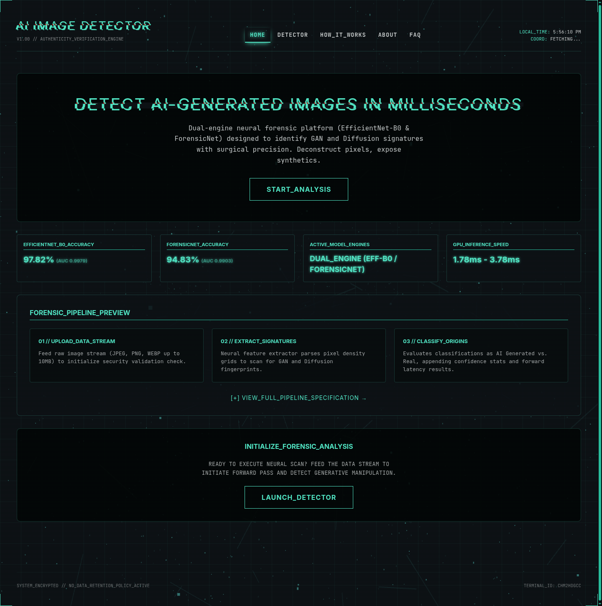
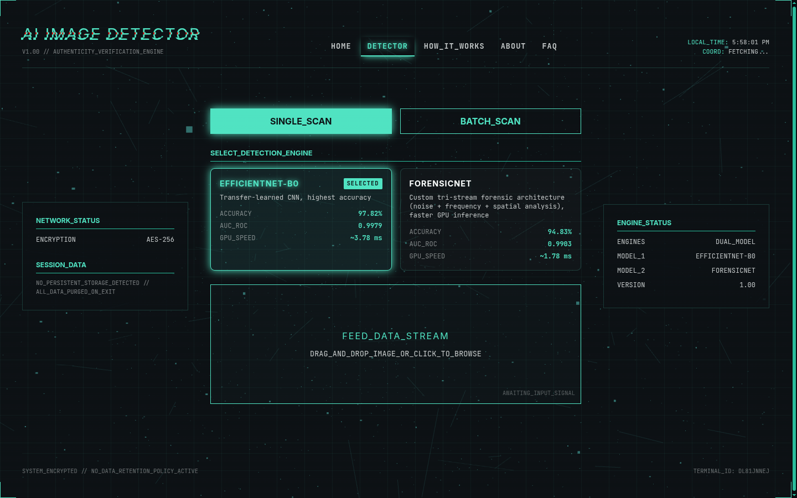
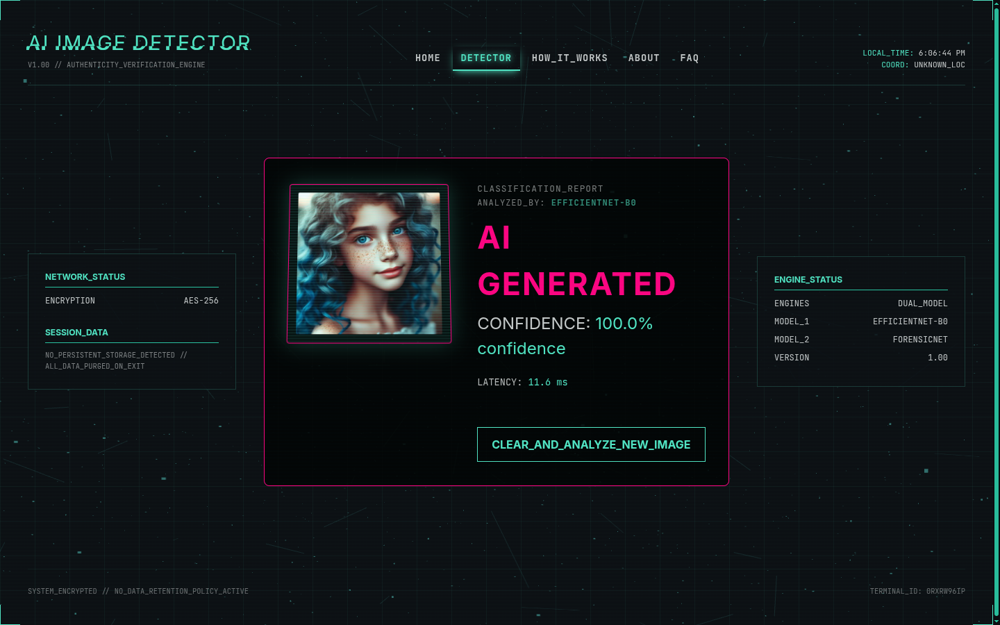
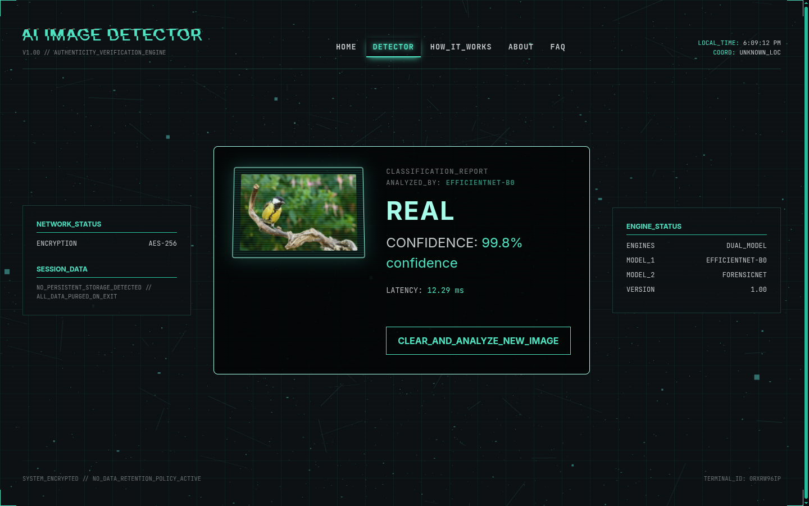
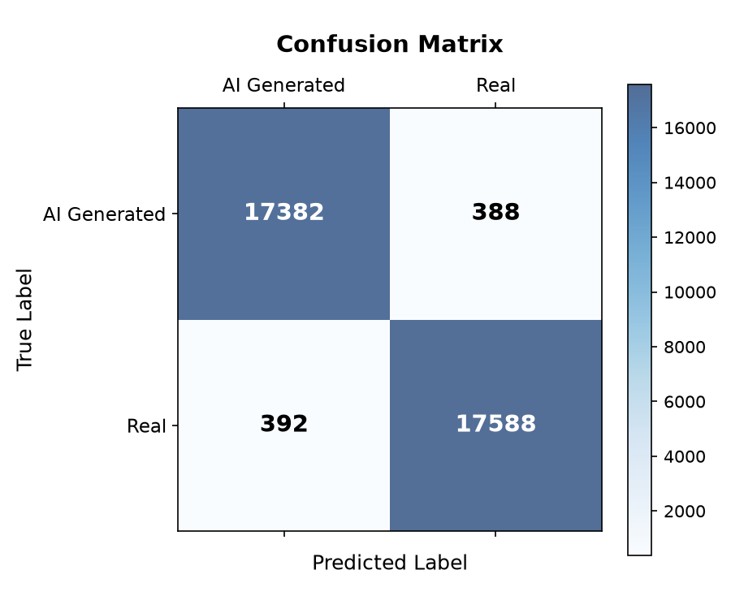
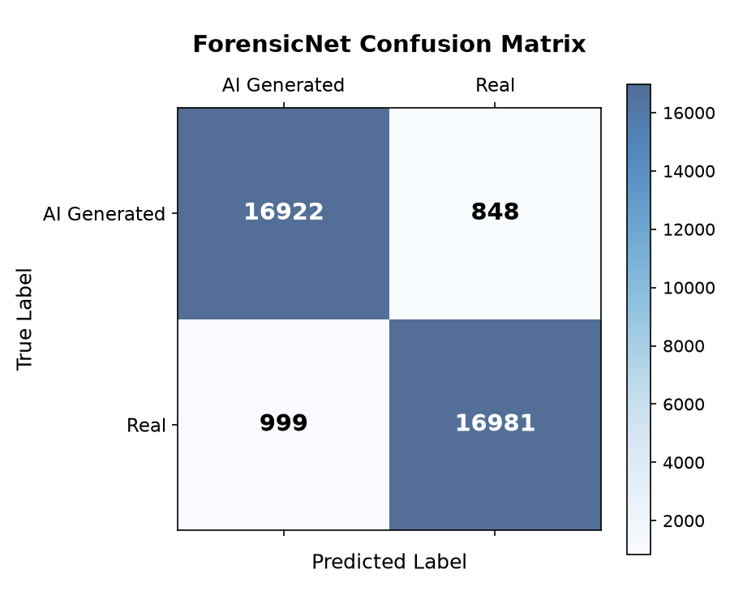
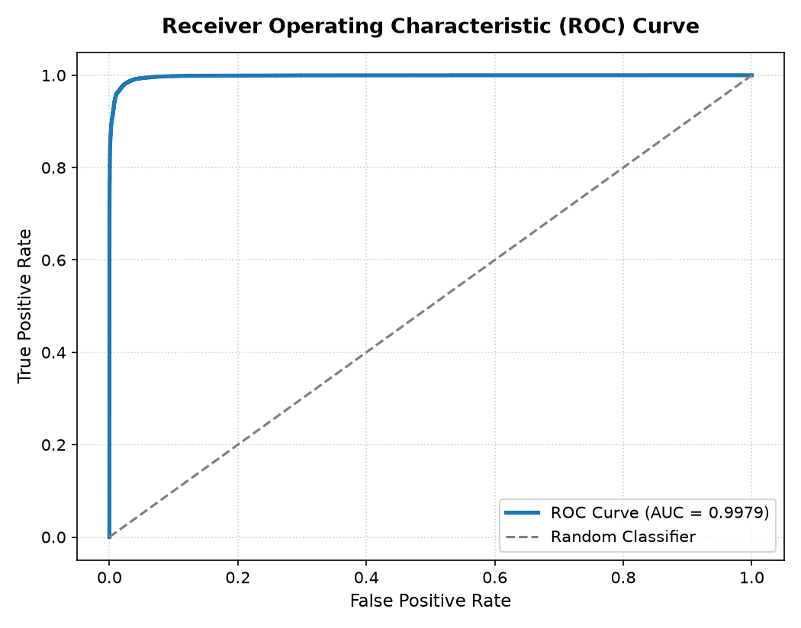
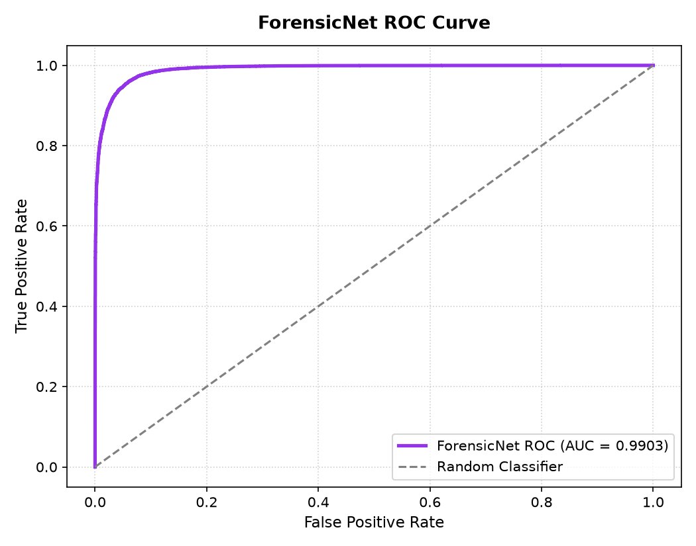

# AI Image Detector

A high-performance, production-ready full-stack web application powered by a dual-engine PyTorch model system (**EfficientNet-B0** & **ForensicNet**) to identify and classify images as Real or AI-Generated with single-digit millisecond latency.

[](https://github.com/shreyansdev/ai-image-detector/actions/workflows/ci.yml)


[](LICENSE)

---

## Interface Preview

| Landing Page | Forensic Scanner |
| :---: | :---: |
|  |  |

| AI-Generated Detection Result | Real Image Verification Result |
| :---: | :---: |
|  |  |

---

## Overview

The rapid advancement of deep generative synthesis (Midjourney, DALL-E, Stable Diffusion) makes distinguishing authentic photography from synthetic imagery increasingly critical. This project provides an end-to-end, local-first forensic detection system combining:

* **Dual-Engine PyTorch Model Serving:**
  * **EfficientNet-B0**: Fine-tuned CNN for maximum classification accuracy (**97.82% Accuracy**, **0.9979 AUC-ROC**).
  * **ForensicNet**: Custom tri-stream deep architecture fusing spatial pixel analysis, noise residual extraction (SRM filters), and frequency domain (DCT) decomposition (**94.83% Accuracy**, **~1.78 ms GPU latency**).
* **High-Throughput Vectorized Batch Inference:** Supports up to 10 images concurrently, stacking valid tensors into a single GPU/CPU matrix operation.
* **Pre-Trained Weights Included:** Both production models (`best_efficientnet_b0.pth` and `best_forensicnet.pth`) come pre-packaged in `backend/ml/model_weights/`, enabling instant out-of-the-box detection with zero manual weight downloads.
* **Cyberforensic React 19 Frontend:** Stark ink-and-canvas aesthetic with neon cyber accents, real-time diagnostic terminal simulator, interactive 3D particle canvas (Three.js), and zero user-data retention.
* **Hardened Enterprise Backend:** FastAPI REST service with binary magic-byte verification, proxy-aware sliding-window rate limiting, HSTS security headers, and immutable static asset caching.

---

## Tech Stack

| Component | Technologies |
| :--- | :--- |
| **Frontend** | React 19, TypeScript, Vite 8, Tailwind CSS v4, Three.js, Lucide Icons |
| **Backend** | FastAPI, Uvicorn, Pydantic v2, Python-dotenv, Aiofiles |
| **Inference & ML** | PyTorch, torchvision, NumPy, Pillow, Scikit-learn, SciPy |
| **Deployment** | Docker (Multi-stage build, non-root user), Docker Compose, GitHub Actions |

---

## Model Benchmarks & Diagnostic Plots

Trained on a balanced dataset of ~238,000 real and synthetic images using mixed-precision (AMP) optimization:

| Metric | EfficientNet-B0 (Accuracy Engine) | ForensicNet (Speed Engine) |
| :--- | :--- | :--- |
| **Test Accuracy** | **97.82%** | **94.83%** |
| **AUC-ROC** | **0.9979** | **0.9903** |
| **Macro Precision** | **97.82%** | **94.84%** |
| **Macro Recall** | **97.82%** | **94.83%** |
| **Macro F1-Score** | **97.82%** | **94.83%** |
| **Parameter Count** | 4.66M | 1.05M |
| **GPU Inference Latency** | ~3.78 ms / image | ~1.78 ms / image |
| **CPU Inference Latency** | ~12.24 ms / image | ~5.60 ms / image |

### Diagnostic Plots

| EfficientNet-B0 Diagnostics | ForensicNet Diagnostics |
| :---: | :---: |
|  |  |
|  |  |

---

## Quickstart Guide

You can run the entire application using Docker, the all-in-one local runner, or standalone development servers.

### Method 1: Docker Compose (Recommended for Production)

```bash
# Clone the repository
git clone https://github.com/shreyansdev/ai-image-detector.git
cd ai-image-detector

# Build and start the containerized service
docker compose up --build
```
Open [http://localhost:8000](http://localhost:8000) in your browser. The container runs with dropped privileges as a dedicated non-root `appuser`.

---

### Method 2: All-in-One Local Runner (`run.py`)

The included [`run.py`](run.py) script automatically compiles frontend assets (if missing), validates dependencies, configures proxy flags, and launches the unified server on a single port:

```bash
# Set up Python virtual environment
python3 -m venv venv
source venv/bin/activate  # On Windows: venv\Scripts\activate

# Install dependencies
pip install -r requirements.txt

# Run all-in-one application
python run.py
```
Open [http://localhost:8000](http://localhost:8000).

---

### Method 3: Manual Developer Setup (Decoupled Vite + Uvicorn)

#### 1. Backend Server
```bash
cd backend
python3 -m venv .venv
source .venv/bin/activate  # On Windows: .venv\Scripts\activate
pip install -r requirements.txt

# Launch FastAPI development server with hot-reload
uvicorn app.main:app --host 0.0.0.0 --port 8000 --reload
```

#### 2. Frontend Server
In a separate terminal:
```bash
cd frontend
npm install
npm run dev
```
Open [http://localhost:5173](http://localhost:5173). The Vite frontend connects to the backend on port `8000`.

---

## REST API Reference

Interactive OpenAPI documentation is available at `http://localhost:8000/docs`.

### 1. Health Status
* **Endpoint:** `GET /health`
* **Response:**
  ```json
  {
    "status": "operational",
    "model_loaded": true,
    "models": {
      "efficientnet": true,
      "forensicnet": true
    },
    "device": "cuda"
  }
  ```

### 2. Available Models Metadata
* **Endpoint:** `GET /api/v1/models`
* **Response:** Returns benchmark metrics, dynamic parameter counts, and availability flags for both engines.

### 3. Single Image Classification
* **Endpoint:** `POST /api/v1/predict`
* **Content-Type:** `multipart/form-data`
* **Body:**
  * `image`: Binary image file (`.jpg`, `.jpeg`, `.png`, `.webp`, max 10MB)
  * `model`: Optional (`efficientnet` or `forensicnet`, default `efficientnet`)
* **Response:**
  ```json
  {
    "label": "AI Generated",
    "confidence": 0.9854,
    "inference_time_ms": 3.71,
    "model_used": "efficientnet",
    "model_display_name": "EfficientNet-B0"
  }
  ```

### 4. Vectorized Batch Classification
* **Endpoint:** `POST /api/v1/predict/batch`
* **Content-Type:** `multipart/form-data`
* **Body:**
  * `images`: Multiple image files (up to 10 per request)
  * `model`: Optional (`efficientnet` or `forensicnet`)
* **Response:** Returns an itemized list of prediction results or per-item validation errors.

---

## Security Features

* **Binary Magic-Byte Inspection:** Verifies raw byte headers (`FF D8 FF` for JPEG, `89 50 4E 47` for PNG, `52 49 46 46...57 45 42 50` for WEBP) to block extension spoofing attacks.
* **Proxy-Aware Sliding Window Rate Limiting:** Enforces client IP limits through reverse proxy headers (`X-Forwarded-For`).
* **Strict HTTP Security Headers:** Appends `Strict-Transport-Security` (HSTS), `X-Content-Type-Options: nosniff`, `X-Frame-Options: DENY`, and `X-XSS-Protection`.
* **Zero Persistence / Privacy by Design:** Uploaded images are preprocessed in-memory byte streams and never written to disk.
* **Non-Root Container Execution:** Docker container runs as unprivileged user `appuser` (UID 1001).

---

## Automated Testing

Run the automated test suite covering all endpoints, security verifications, rate limiting, and batch inference:

```bash
pytest backend/tests/ -v
```

All 22 tests pass:
```text
backend/tests/test_api.py::test_health_endpoint PASSED
backend/tests/test_api.py::test_predict_valid_jpeg PASSED
backend/tests/test_api.py::test_predict_valid_png PASSED
backend/tests/test_api.py::test_predict_rejects_non_image PASSED
backend/tests/test_api.py::test_predict_rejects_oversized_file PASSED
backend/tests/test_api.py::test_predict_rejects_corrupted_image PASSED
backend/tests/test_api.py::test_magic_bytes_validation PASSED
backend/tests/test_api.py::test_inference_service_output_shape PASSED
backend/tests/test_api.py::test_get_models_endpoint PASSED
backend/tests/test_api.py::test_predict_with_efficientnet_model PASSED
backend/tests/test_api.py::test_predict_with_forensicnet_model PASSED
backend/tests/test_api.py::test_predict_with_invalid_model PASSED
backend/tests/test_api.py::test_predict_batch_valid PASSED
backend/tests/test_api.py::test_predict_batch_with_forensicnet PASSED
backend/tests/test_api.py::test_predict_batch_exceeds_max PASSED
backend/tests/test_api.py::test_predict_batch_partial_success PASSED
backend/tests/test_api.py::test_unavailable_model_returns_503 PASSED
backend/tests/test_api.py::test_security_headers_include_hsts PASSED
backend/tests/test_api.py::test_rate_limiter_uses_forwarded_for PASSED
backend/tests/test_api.py::test_batched_tensor_forward_pass PASSED
backend/tests/test_api.py::test_find_model_weights_path_env_override PASSED
backend/tests/test_api.py::test_static_asset_cache_control_headers PASSED
======================== 22 passed in 2.39s ========================
```

---

## Project Structure

```text
ai-image-detector/
├── .github/
│   └── workflows/
│       └── ci.yml                 # GitHub Actions CI workflow
├── backend/
│   ├── app/
│   │   ├── routes/predict.py      # REST endpoints (single & batch inference)
│   │   ├── services/inference.py  # PyTorch dual-engine inference service
│   │   ├── utils/security.py      # Magic-byte validation & security helpers
│   │   └── main.py                # FastAPI app, security middleware & asset caching
│   ├── ml/
│   │   ├── model_weights/         # Pre-trained weights (EfficientNet & ForensicNet)
│   │   ├── custom_model.py        # Tri-stream ForensicNet architecture
│   │   ├── dataset.py             # PyTorch dataset & transforms
│   │   ├── train.py               # EfficientNet fine-tuning pipeline
│   │   ├── train_custom.py        # ForensicNet training pipeline
│   │   └── evaluate.py            # Model benchmarking & ROC generator
│   ├── tests/
│   │   ├── conftest.py            # Synthetic image test fixtures
│   │   └── test_api.py            # 22 automated unit/integration tests
│   ├── .env.example               # Backend environment template
│   └── requirements.txt           # Pinned Python dependencies
├── frontend/
│   ├── public/                    # Favicon, SVG icons, robots, sitemap
│   ├── src/
│   │   ├── components/            # Scanner, Results, ModelSelector, ErrorBoundary
│   │   ├── pages/                 # Home, Detector, HowItWorks, About, FAQ
│   │   ├── services/api.ts        # API client with decoupled URL precedence
│   │   ├── styles/theme.css       # Reconciled cyberforensic styling system
│   │   ├── App.tsx                # Client-side router & navigation
│   │   └── Background3D.tsx       # Dynamic Three.js particle canvas
│   ├── package.json
│   └── vite.config.ts
├── screenshots/                   # Application demonstration previews
├── Dockerfile                     # Multi-stage production container build
├── docker-compose.yml             # Container orchestration config
├── run.py                         # All-in-one local launcher
├── start.sh                       # Linux/macOS start script
├── start.bat                      # Windows start script
├── requirements.txt               # Root buildpack compatibility pointer
├── LICENSE                        # MIT License
└── README.md
```

---

## License

Distributed under the [MIT License](LICENSE).
